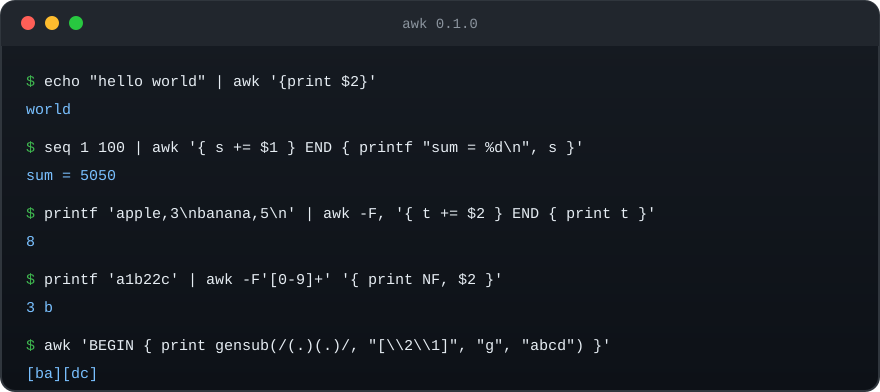
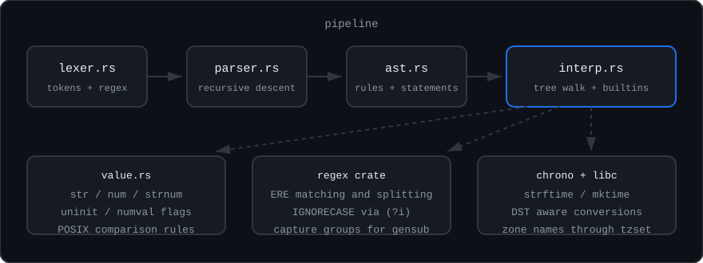

# awk

[](https://github.com/hakuxyz/awk/actions/workflows/ci.yml)
[](https://crates.io/crates/awk)
[](https://docs.rs/awk)
[](https://crates.io/crates/awk)
[](LICENSE)
[](https://www.rust-lang.org)
[](#features)
[](#gnu-extensions)

A fast `awk` written in Rust. It is a drop-in replacement for the system `awk`,
built to be used as a full alternative to GNU awk rather than as a teaching
implementation. It starts faster than gawk and is competitive on text
processing, while gawk still leads on numeric-heavy loops; see
[Benchmarks](#benchmarks).



## Highlights

- Complete POSIX awk: patterns, range patterns, `BEGIN`/`END`, `getline`
  variants, redirections, user functions, dynamic fields
- The GNU extensions that show up in real scripts: `gensub`, `asort`, `asorti`,
  `strtonum`, `typeof`, `isarray`, `compl`, `and`, `or`, `xor`, `lshift`,
  `rshift`, `ARGIND`, `ENVIRON`, `IGNORECASE`, `nextfile`, `mktime`, `strftime`
- Correct value model: every scalar carries string and number parts with the
  `strnum` rules POSIX requires, including input fields and `-v` assignments
- Unicode aware: field indexes, `length`, `substr`, `match` and `RSTART` all
  count characters instead of bytes
- Small and self contained: two dependencies (`regex`, `chrono`), no runtime
  configuration, single static binary

## Install

Prebuilt binaries for Linux, macOS and Windows are attached to every
[GitHub release](https://github.com/hakuxyz/awk/releases).

From crates.io:

```console
$ cargo install awk
```

Build from source:

```console
$ git clone https://github.com/hakuxyz/awk
$ cd awk
$ cargo build --release
$ install -m 755 target/release/awk /usr/local/bin/awk
```

Or straight into your cargo bin directory:

```console
$ cargo install --path .
```

## Usage

```text
usage: awk [-F fs] [-v var=value] [-f progfile | 'prog'] [file ...]

    -F fs           field separator (char, string, or regex)
    -v var=value    assign variable before execution
    -f progfile     read program from file
    --version       print version
```

Exit codes follow gawk: `0` success, `1` for syntax and usage errors (or a
script calling `exit 1`), `2` for runtime errors such as an unreadable file.

```console
$ echo "hello world" | awk '{print $2}'
world

$ seq 1 100 | awk '{ s += $1 } END { print s }'
5050

$ printf 'apple,3\nbanana,5\n' | awk -F, '{ t += $2 } END { print t }'
8
```

## Features

### POSIX awk

- Patterns, range patterns, `BEGIN`/`END`, `next`, `exit`, `break`, `continue`
- Field splitting with the default whitespace rule, a single character, a
  string, or an extended regular expression (`-F '[0-9]+'`)
- Dynamic fields (`$100`), `NF`, `NR`, `FNR`, `FILENAME`, `OFS`, `ORS`,
  `SUBSEP`, `CONVFMT`, `OFMT`, `ENVIRON`
- String functions: `length`, `substr`, `index`, `split`, `sub`, `gsub`,
  `match`, `sprintf`, `toupper`, `tolower`
- Math: `int`, `sqrt`, `log`, `exp`, `sin`, `cos`, `atan2`, `rand`, `srand`
- `printf`/`sprintf` with `%d %i %o %x %X %f %F %e %E %g %G %a %A %s %c %%`,
  field widths, precision, flags, and `*` width or precision taken from an
  argument
- I/O redirection `>`, `>>`, `|` for both `print` and `getline`
- `getline` forms: plain, `var`, `< file`, `| cmd`, and `cmd | getline var`

### GNU extensions

- `gensub` with `\1` to `\9` group references and a match selector
- `asort`, `asorti` with optional destination array
- `strtonum` with `0x` hex and leading zero octal prefixes
- `typeof` distinguishing `untyped`, `unassigned`, `strnum`, `number`,
  `string` and `array`
- `isarray`, `compl`, `and`, `or`, `xor`, `lshift`, `rshift`
- `IGNORECASE` for matching and field splitting
- `ARGIND`, `RT` style specials covered where scripts rely on them
- `mktime` and `strftime` with local time, DST handling and `LC_TIME` names
- `nextfile` to skip the rest of the current input file
- Hex integer literals such as `0x263a`



## Library

The crate also exposes the lexer, parser, AST, value model, and interpreter for
embedding:

```rust
let (funcs, prog) = awk::parser::parse_full(r#"BEGIN { print "hi" }"#).unwrap();
let mut interp = awk::interp::Interp::new(funcs, match prog {
    awk::ast::Program::Rules(r) => r,
});
let code = interp.run(&[]);
assert_eq!(code, 0);
```

The library API exists so the CLI engine can be reused, not as a polished
public interface. It is not stable yet: while the crate is in 0.x, minor
versions may change it, so pin an exact version if you embed it. A documented,
stabilized API may follow in a later release.

## Testing

Two layers keep the behaviour honest:

- `cargo test` runs 39 integration tests against the built CLI
- `python3 tools/difftest.py` runs 125 programs under both this `awk` and the
  system `gawk` and compares stdout, stderr and the exit status

```console
$ cargo test
$ cargo clippy --all-targets
$ python3 tools/difftest.py
```

CI runs the format check, Clippy, both test layers and the differential
harness on every push (`.github/workflows/ci.yml`).

## Benchmarks

`tools/bench.sh` compares against gawk 5.4.1 on the same machine
(one warm run per workload, milliseconds):

| workload                     | awk   | gawk  |
|------------------------------|-------|-------|
| sum 3M records               | 3170  | 622   |
| print `$1 $3`, 3M records    | 3152  | 705   |
| regex filter 1M records      | 4159  | 517   |
| regex FS, 1M records         | 1065  | 975   |
| gsub, 1M records             | 1976  | 381   |
| string FS, 1M records        | 838   | 257   |
| startup x1000 (`/etc/passwd`)| 1466  | 1878  |

The honest summary: startup and small jobs are faster here, and regex field
splitting is on par, but gawk's C interpreter is still several times faster on
record-heavy numeric loops. Run `tools/bench.sh` to reproduce.

## Known differences from gawk

- `for (k in arr)` iterates keys in sorted order. gawk uses hash order, which
  is unspecified, so sorted order is the deterministic choice here
- Error message wording differs, only the exit status matches
- `compl`, `and` and friends follow gawk's 53 bit masking rules
- Some rarely used gawk internals (`FUNCTAB`, `PROCTAB`, `bindtextdomain`)
  are not implemented

## License

[MIT](LICENSE)
